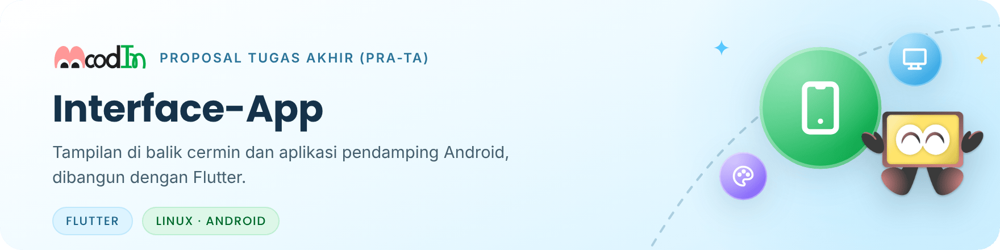
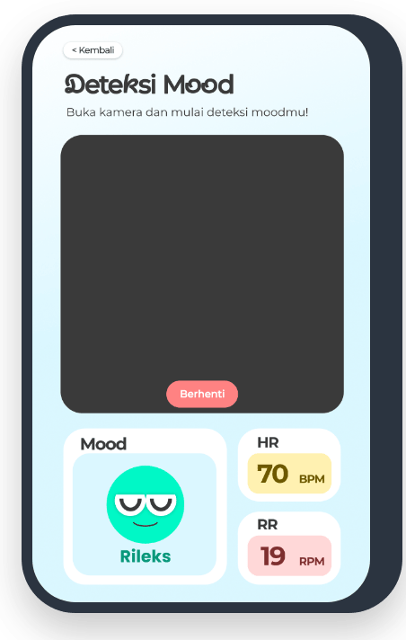
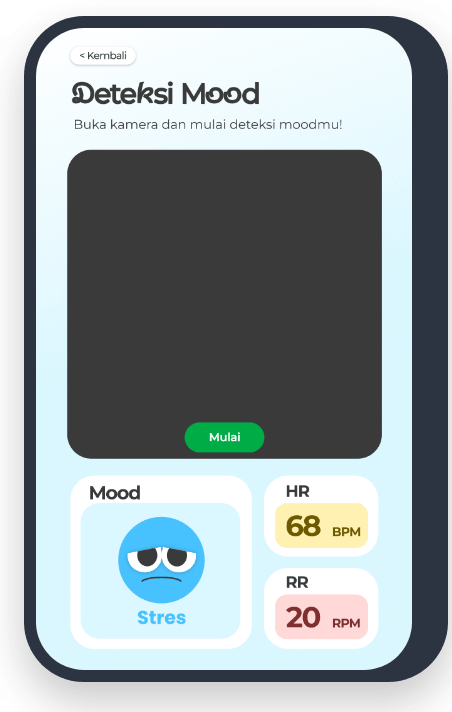
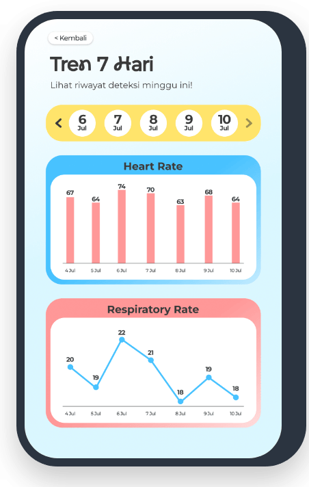

<picture>
  <source media="(prefers-color-scheme: dark)" srcset=".github/readme/banner-dark.png">
  
</picture>

<p align="center">
  <a href="#dua-aplikasi-satu-basis-kode">Dua aplikasi</a> ·
  <a href="#desain-awal-era-gemastik">Desain awal</a> ·
  <a href="#rencana">Rencana</a> ·
  <a href="#prinsip-tampilan">Prinsip tampilan</a> ·
  <a href="#aset">Aset</a>
</p>

Repositori ini berisi "wajah" MoodIn: semua yang dilihat dan disentuh pengguna. Antarmuka menerima hasil pemeriksaan berupa angka lewat MQTT di jaringan lokal, lalu menampilkannya sebagai kategori suasana hati, tingkat stres, dan tanda vital pendukung. Antarmuka tidak pernah menerima citra wajah.

Repositori ini menggantikan [Interface-Display](https://github.com/MoodInBME/Interface-Display) (PySide6 + QML), yang sudah diarsipkan, dan merupakan bagian dari proyek [MoodIn](https://github.com/MoodInBME/MoodIn-master) yang saat ini dikembangkan sebagai Proposal Tugas Akhir (Pra-TA).

<p>
  
  
  
</p>

> [!NOTE]
> **Status (28 Okt 2026):** belum ada kode. Pengembangan dimulai di milestone M3, diawali uji kelayakan Flutter di Jetson.

## Dua aplikasi, satu basis kode

<table>
  <tr>
    <td width="50%" valign="top">
      <br>
      <b>Tampilan cermin</b><br>
      Berjalan di NVIDIA Jetson Orin Nano Super (Linux) dan tampil di balik cermin dua arah. Menyapa pengguna, meminta persetujuan, memandu pengukuran singkat, lalu menampilkan hasil.
    </td>
    <td width="50%" valign="top">
      <br>
      <b>Aplikasi pendamping</b><br>
      Aplikasi Android untuk akun, riwayat, dan pengaturan. Pengguna dapat melihat tren hasil pemeriksaan harian dan mingguan.
    </td>
  </tr>
</table>

Keduanya dibangun dengan Flutter supaya tema, komponen, dan model pesan cukup ditulis sekali lalu dipakai bersama.

## Desain awal (era GEMASTIK)

Tangkapan layar berikut berasal dari desain Figma era GEMASTIK dan menjadi titik awal desain tahap Pra-TA. **Ini bukan desain final.** Label, angka, dan alur akan disesuaikan; angka pada layar hanyalah contoh.

<table>
  <tr>
    <td align="center" width="25%"></td>
    <td align="center" width="25%"></td>
    <td align="center" width="25%"></td>
    <td align="center" width="25%"></td>
  </tr>
  <tr>
    <td align="center"><sub><b>Layar pembuka</b></sub></td>
    <td align="center"><sub><b>Hasil pemeriksaan</b><br>contoh: Rileks</sub></td>
    <td align="center"><sub><b>Hasil pemeriksaan</b><br>label era GEMASTIK</sub></td>
    <td align="center"><sub><b>Tren 7 hari</b><br>di aplikasi</sub></td>
  </tr>
</table>

## Rencana

1. **Uji kelayakan di Jetson** (Ubuntu 24.04, JetPack 7.2): _build_ Flutter untuk Linux, mode layar penuh, orientasi _portrait_, serta pemakaian CPU dan RAM saat model berjalan bersamaan. Bila ada kendala, hasil uji dibawa ke bimbingan sebelum layar dipindahkan.
2. **Kerangka monorepo** (rencana, dapat berubah):

   ```text
   Interface-App/
   ├── apps/
   │   ├── mirror/            tampilan cermin (Linux, Jetson)
   │   └── companion/         aplikasi pendamping (Android)
   └── packages/
       ├── moodin_contracts/  model pesan MQTT sesuai kontrak pesan v2
       └── moodin_ui/         tema, komponen, dan aset bersama
   ```

3. **Layar dari desain Figma.** Berkas Figma tidak dipublikasikan; hanya tangkapan layar terpilih yang ditampilkan di atas.
4. **Klien kontrak pesan v2**, setelah kontrak ditetapkan di MoodIn-master.

## Prinsip tampilan

Prinsip berikut dibawa dari Interface-Display dan tetap berlaku untuk desain baru.

<table>
  <tr>
    <td width="33%" valign="top">
      <br>
      <b>Tanpa angka basi</b><br>
      Tidak menampilkan angka lama atau hasil dari jendela pengukuran yang belum penuh; tampilkan indikator kemajuan.
    </td>
    <td width="33%" valign="top">
      <br>
      <b>Mode demo terlihat jelas</b><br>
      Mode demo atau simulasi selalu diberi penanda yang terlihat.
    </td>
    <td width="33%" valign="top">
      <br>
      <b>Angka, bukan gambar</b><br>
      Antarmuka tidak pernah menerima citra wajah; hanya nilai numerik.
    </td>
  </tr>
</table>

## Aset


Aset visual era GEMASTIK yang dipakai ulang, seperti logo, maskot, dan ikon suasana hati, disalin dari Interface-Display atau dari berkas Figma tim. Asal setiap aset dicatat di `CHANGELOG.md` saat disalin. Gambar untuk README ini ada di [`.github/readme/`](.github/readme/) beserta [kreditnya](.github/readme/KREDIT.md).

## Lisensi

Belum ditetapkan; menunggu keputusan bersama calon dosen pembimbing.

---

<div align="center">
<sub>
Departemen Teknik Biomedik · Fakultas Teknologi Elektro dan Informatika Cerdas (FTEIC)<br>
Institut Teknologi Sepuluh Nopember · Surabaya, Indonesia
</sub>
<br><br>
<sub>Ikon antarmuka: <a href="https://tabler.io/icons">Tabler Icons</a> (MIT). Logo, maskot, ikon suasana hati, dan tangkapan layar: desain tim MoodIn era GEMASTIK.</sub>
</div>
